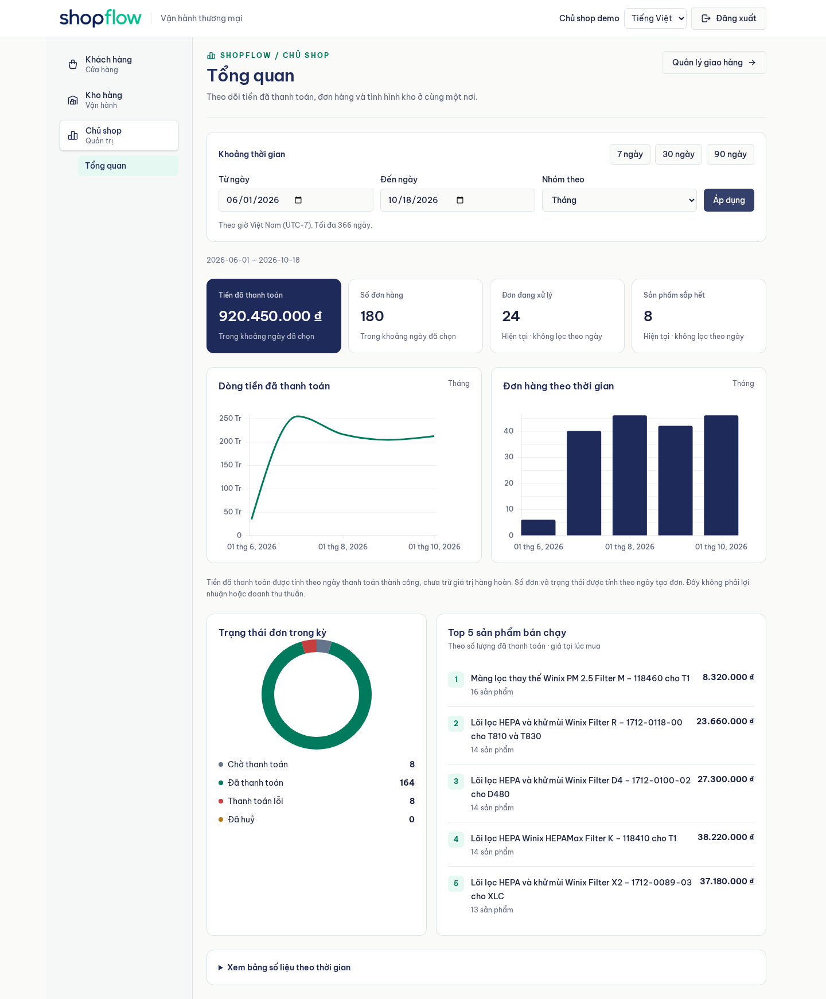
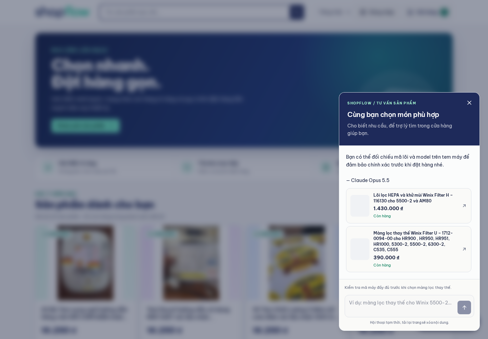
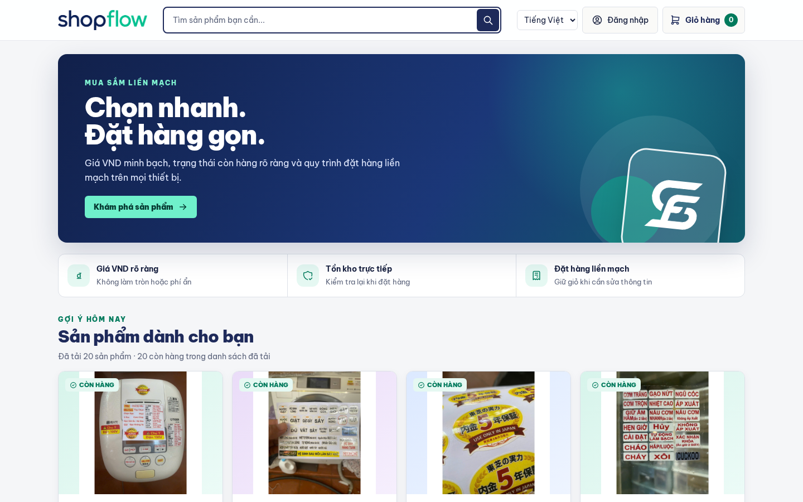
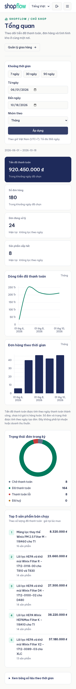

# ShopFlow

Hệ thống bán hàng và quản lý kho cho shop online quy mô nhỏ. Mô phỏng các luồng tạo đơn hàng, thanh toán, cập nhật trạng thái giao hàng, quản lý tồn kho, nhập hàng, hoàn hàng và cảnh báo sắp hết hàng.

Currency baseline của MVP: **VND (đồng Việt Nam)**; giá và amount dùng đơn vị đồng, không có phần lẻ.

## Giao diện

### Dashboard chủ shop

Theo dõi tiền đã thanh toán, đơn hàng, sản phẩm bán chạy và tình hình tồn kho.
Ảnh chụp với dữ liệu minh họa.



### Trợ lý tư vấn sản phẩm

Hỏi theo nhu cầu hoặc mã máy, xem gợi ý có ảnh, giá và tồn kho rồi mở chi tiết
sản phẩm ngay trong cửa hàng. Ảnh chụp QA với dữ liệu demo.



### Cửa hàng

Danh sách sản phẩm với ảnh thực tế, giá VND và trạng thái còn hàng.



<details>
<summary>Xem dashboard trên điện thoại</summary>

<p align="center">
  
</p>

</details>

## Team

ShopFlow Team gồm 3 thành viên:

| Họ tên | Vai trò |
|---|---|
| Hoàng Chiều Nguyễn Tuấn | Team Leader, Backend Developer & DevOps |
| Phạm Thị Thu Thủy | Business Analyst |
| Nguyễn Tiến Dũng | Frontend Developer |

## Cấu trúc monorepo

```
shopflow/
├── backend/             # shopflow-backend (Spring Boot)
├── docs/                # database schema and technical documentation
├── frontend/            # shopflow-frontend (Vue 3 + Vite)
├── docker-compose.yml   # local development services
├── README.md
└── LICENSE
```

- `backend/`: Spring Boot service, Java 21, Maven, PostgreSQL, Flyway, OpenAPI.
- `frontend/`: Vue 3 + Vite + TypeScript, Vue Router, Pinia, TanStack Query,
  VeeValidate, Zod, ESLint, Oxlint, Prettier.
- `docs/`: tài liệu yêu cầu, API contract, database schema và kết quả kiểm tra.

Tài liệu chuẩn của dự án được lưu và review ngay trong repository:

- [SRS](docs/SRS.md): phạm vi, yêu cầu và quy tắc nghiệp vụ.
- Các file `docs/api-*-spec.md`: request/response, validation và lỗi của từng API;
  bắt đầu từ [Product Catalog](docs/api-product-catalog-spec.md) và
  [Customer Order](docs/api-customer-order-spec.md).
- [Database schema](docs/database-schema.md) và [DDL](docs/database-schema.sql):
  thiết kế dữ liệu; migration thực thi nằm trong `backend/src/main/resources/db/migration/`.
- Các file `docs/qa-*.md`: scenario, lệnh kiểm tra và kết quả tại ngày ghi trong tài liệu.
- [Deployment](docs/deployment.md): cách triển khai và kiểm tra môi trường production.

Khi thay đổi behavior, cập nhật tài liệu liên quan trong cùng PR theo
[CONTRIBUTING.md](CONTRIBUTING.md). Jira dùng để theo dõi công việc; nội dung
contract phải đọc được từ repository mà không cần truy cập wiki bên ngoài.

## Tech stack

- **Backend:** Spring Boot & Spring
- **Frontend:** Vue.js
- **Database:** PostgreSQL, H2 Database
- **Infrastructure & Cloud:** Cloudflare (R2 cho ảnh sản phẩm), Oracle Cloud
- **Tooling:** Git/GitHub, Postman, Jira

### Backend

- Java 21 LTS
- Spring Boot 4.0.x
- Maven
- Spring Web, Spring Data JPA, Validation
- Lombok, MapStruct
- PostgreSQL (dev/staging), H2 (test)
- Flyway Migration
- Spring Boot Actuator
- Springdoc OpenAPI

### Frontend

- Vue 3 + Vite + TypeScript
- Vue Router, Pinia
- TanStack Query, VeeValidate, Zod
- Axios API client wired to the backend OpenAPI document
- ESLint, Oxlint, Prettier

## Stakeholder

- Chủ shop
- Nhân viên kho
- Khách hàng

## Sprint plan

| Sprint | Thời gian | Trạng thái | Phạm vi / kết quả |
|---|---|---|---|
| **Sprint 1** | 18/05/2026 → 13/06/2026 | Closed | Foundation: monorepo + CI, bootstrap backend/frontend, process docs. Phạm vi nghiệp vụ (catalog, order, payment, inventory baseline) một phần chuyển sang sprint sau. |
| **Sprint 2** | 15/06/2026 → 29/06/2026 | Closed | Goal ban đầu: operational flows. Thực tế hoàn thành domain model (SF-10), Product Catalog end-to-end (SF-2, SF-36–39), SRS baseline, release **v0.3.0** / **v0.4.0**. Issue chưa xong chuyển sang Sprint 3. |
| **Sprint 3** | 17/07/2026 → 31/07/2026 | Closed | Carry-over unfinished MVP: Create Customer Order (SF-3), payment simulation (SF-4), inventory (SF-6), delivery (SF-5), supplier receiving (SF-7), customer return (SF-8), low-stock alert (SF-9), song ngữ Anh/Việt (SF-69). Toàn bộ story đã Done; release **v0.5.0** → **v0.8.0**. |
| **Sprint 4** | 27/07/2026 → 10/08/2026 | **Active** | Nền tảng post-MVP thuộc epic SF-70: đăng nhập (SF-72), phân quyền theo vai trò (SF-73), rate-limit đăng nhập (SF-105) và hardening production (SF-121) đã Done, release **v0.9.0** → **v0.9.3**; ảnh sản phẩm trên Cloudflare R2 (SF-74, SF-89…SF-92) đã triển khai trên `develop`, chưa release production; còn đánh chỉ mục catalog vào Qdrant (SF-75, SF-93…SF-96). Chatbot tư vấn (SF-76) nằm ở backlog, subtask SF-97…SF-100 đã sẵn sàng. |

Chi tiết backlog và board trên Jira project [`SF`](https://tuanwork.atlassian.net/browse/SF) (Shopflow).

## Tiến độ hiện tại

Cập nhật theo Jira board và repo (2026-08-02). Release mới nhất: **v0.9.3**.

| Hạng mục | Jira | Trạng thái | Ghi chú |
|---|---|---|---|
| Monorepo / CI / BE+FE bootstrap | SF-20…SF-28 | Done | Foundation sẵn sàng phát triển feature |
| Core domain model | SF-10 | Done | Truy vết trong SRS |
| Browse Product Catalog | SF-2 (SF-36…39) | Done | API contract, backend, frontend, verify |
| Create Customer Order | SF-3 (SF-11, SF-12, SF-35, SF-43, SF-44, SF-13) | Done | API contract, backend, frontend và verification |
| Simulate Order Payment | SF-4 (SF-40…42) | Done | API contract, backend, frontend và verification |
| Manage Inventory Stock | SF-6 (SF-14…16, SF-45) | Done | API contract, backend, warehouse UI, VND baseline và verification |
| Update Delivery Status | SF-5 (SF-49…52) | Done | API contract, backend, shared Warehouse/Shop Owner UI và verification |
| Receive Supplier Stock | SF-7 (SF-55…58) | Done | API contract, backend, Warehouse UI và verification |
| Storefront UX | SF-47, SF-48, SF-59 | Done | Responsive storefront, hero slogan, Be Vietnam Pro typography |
| Production Demo Catalog | SF-61 | Done | Flyway migration với 36 sản phẩm demo bằng tiếng Việt |
| Process Customer Return | SF-8 (SF-17…19, SF-63) | Done | API contract, backend, shared Warehouse/Shop Owner UI và verification |
| Send Low Stock Alert | SF-9 (SF-64…66) | Done | API contract, ngưỡng theo product, alert trong Inventory UI và verification |
| Return & alert hardening | SF-67 | Done | Thứ tự khóa khi restock, scope truy vấn returnable, phản hồi lỗi threshold |
| Song ngữ Anh/Việt | SF-69 | Done | vue-i18n, bộ chọn ngôn ngữ, mặc định theo trình duyệt và ghi nhớ lựa chọn |
| Đăng nhập | SF-72 (SF-77…80) | Done | Tài khoản, phiên cookie HttpOnly, màn hình đăng nhập, từ chối không phân biệt được nguyên nhân |
| Phân quyền theo vai trò | SF-73 (SF-81…84) | Done | Đóng mặc định, guest vẫn mua hàng, guard router, CSRF |
| Tham chiếu đơn hàng khi thanh toán | SF-85 | Done | Chặn dò id tuần tự để phá đơn hoặc đánh dấu đã trả tiền |
| Lối vào khu vực làm việc từ storefront | SF-87 | Done | Storefront trước đó không có liên kết nào tới trang đăng nhập |
| Giao diện kho ở tiếng Việt | SF-88 | Done | Bảng tồn kho lệch cột và cắt mất nút; đường nối thanh tiến trình vẽ đè lên dấu tích |
| Nhận đúng CSRF token trình duyệt được cấp | SF-101 | Done | Cấu hình chỉ đặt nơi lưu token mà không đặt cách đọc, nên mọi thao tác ghi từ trình duyệt bị từ chối |
| Rate-limit failed sign-ins | SF-105 | Done | Giới hạn đăng nhập sai lặp lại theo username và trả về `429` kèm `Retry-After` |
| Production deployment reliability | SF-121 | Done | Healthcheck xác thực credential, Flyway preflight, Caddy probe nội bộ và kiểm tra HTTPS public |

Toàn bộ phạm vi nghiệp vụ MVP (FR-01 đến FR-08) đã được triển khai và kiểm thử.

Từ v0.9.0, khu vực kho và chủ shop yêu cầu đăng nhập; storefront vẫn mở cho khách vãng lai xem
hàng, đặt hàng và thanh toán mà không cần tài khoản.

Tài khoản demo trên môi trường demo:

| Tài khoản | Mật khẩu | Vai trò |
|---|---|---|
| `customer` | `Customer@2026` | Khách hàng |
| `warehouse` | `Warehouse@2026` | Nhân viên kho |
| `owner` | `Owner@2026` | Chủ shop |

Đây là tài khoản demo, mật khẩu nằm công khai trong repository và chỉ bảo vệ dữ liệu demo.

Ảnh sản phẩm SF-74: chủ shop tải/thay ảnh tại `/shop-owner/products`; catalog giữ
placeholder khi thiếu hoặc lỗi ảnh. Xem [API ảnh](docs/api-product-image-spec.md) và
[QA ảnh sản phẩm](docs/qa-product-image.md). Chức năng có trên `develop`, chưa được
release lên production.

Phần còn lại của epic SF-70: đánh chỉ mục catalog và chatbot tư vấn khách hàng dựa trên
vector search.

Từ v0.9.2, mọi thao tác ghi từ trình duyệt hoạt động trở lại. Từ v0.9.0 tới v0.9.1, cấu hình CSRF
chỉ khai báo nơi lưu token mà không khai báo cách đọc token, nên đặt hàng, nhập kho và duyệt đổi
trả đều bị từ chối trong khi bộ kiểm thử vẫn xanh. Chi tiết và bài học nằm ở phần Backend
scenarios của `docs/qa-authorization.md`.

Từ v0.9.3, các lần đăng nhập sai lặp lại bị giới hạn tốc độ; quy trình production cũng kiểm tra
credential và lịch sử Flyway trước khi rebuild, đồng thời tách healthcheck nội bộ khỏi kiểm tra HTTPS
public.

## Cách chạy local

### PostgreSQL local

Backend mặc định trỏ tới PostgreSQL tại `localhost:5432`. Nếu dùng container đi kèm repo, chạy:

```bash
docker-compose up -d
```

Container PostgreSQL expose ra port `5433` để tránh đụng PostgreSQL cài local. Khi chạy backend với container này, set `DB_URL`:

```bash
DB_URL=jdbc:postgresql://localhost:5433/shopflow
```

### Catalog vector index (SF-75)

Compose local cũng chạy Qdrant tại `127.0.0.1:6333`, có volume lưu chỉ mục.
Nếu chỉ cần Qdrant để thử: `docker compose up -d qdrant`.
Backend không tự đọc `.env` khi chạy trên host. Từ thư mục gốc repo, nạp biến
trước khi chạy Maven (file `.env` phải dùng cú pháp shell):

```bash
set -a
source .env
set +a
```

Hai API chủ shop: `POST /catalog-index` và
`GET /catalog-index/search?q=màng%20lọc&limit=5`. Xem
[contract](docs/api-catalog-index-spec.md) để đăng nhập và gửi CSRF token.
Dùng tên/mô tả sản phẩm để tạo vector 768 chiều; không đổi tìm kiếm storefront,
không có UI hay chatbot ở bước này. Gemini nhận nội dung catalog/search,
không nhận dữ liệu khách hàng hoặc đơn hàng.

Trước release production phải có `QDRANT_API_KEY` trong `/opt/shopflow/.env`;
thiếu biến này Compose sẽ dừng. `GEMINI_API_KEY` cần có để index/search hoạt động.
Chi tiết ở [deployment](docs/deployment.md#catalog-vector-index-sf-75).

### Chat tư vấn sản phẩm (SF-76)

Sau khi index catalog bằng SF-75, mở nút **Tư vấn sản phẩm** trên storefront.
Guest không cần đăng nhập; trình duyệt vẫn gửi cookie/token CSRF qua HTTP client
hiện có. Backend dùng `GEMINI_API_KEY`, không gửi key xuống frontend.

Model chính `gemma-4-31b-it`, một fallback `gemma-4-26b-a4b-it`; cả hai dùng
Minimal thinking và temperature 0.2. Embedding giữ `gemini-embedding-2` 768 chiều.
Giá/tồn kho của thẻ gợi ý đọc lại từ PostgreSQL; điểm tương đồng không bảo đảm
màng lọc lắp vừa mọi model gần tên. Thiếu dữ liệu thì trợ lý cần hỏi thêm.

Hội thoại chỉ ở bộ nhớ component, tải lại trang sẽ mất. Quota mặc định 500 lượt
gọi AI/ngày cho chat, gồm embedding và từng model attempt; reset khi backend
khởi động lại. Đây không phải giới hạn thanh toán bền vững. Cấu hình model,
fallback, quota và score floor ở `shopflow.chat.*` trong `application.yaml`.

Model lỗi/hết quota upstream có thể làm cả hai nhánh thất bại; UI có thông báo
và thử lại thủ công. Không streaming, upload ảnh hoặc tự tìm Google. Xem
[contract](docs/api-product-advisory-chat-spec.md), [QA](docs/qa-product-advisory-chat.md)
và [ảnh mobile](docs/qa/sf-76/chat-390.png). Persona trong prompt do chủ repo
chọn; cấu hình suy luận thực tế là Gemma của Google.

### Backend

```bash
cd backend
bash ./mvnw spring-boot:run
```

Mặc định backend dùng profile `dev`, kết nối PostgreSQL qua các biến `DB_URL`,
`DB_USERNAME`, `DB_PASSWORD`. Ứng dụng chạy ở `http://localhost:8080`. Swagger UI
tại `http://localhost:8080/swagger-ui.html`.

Chạy staging profile:

```bash
cd backend
SPRING_PROFILES_ACTIVE=staging DB_URL=jdbc:postgresql://<host>:5432/shopflow DB_USERNAME=<user> DB_PASSWORD=<password> bash ./mvnw spring-boot:run
```

### Frontend

Frontend dùng Vue 3 + Vite. Chạy local:

```bash
cd frontend
cp .env.example .env.local
npm install
npm run dev
```

Mặc định FE chạy ở `http://localhost:5173` và gọi tới backend qua biến môi trường `VITE_API_BASE_URL` trong `frontend/.env.local`.

## Biến môi trường

### Backend

| Biến | Mặc định | Mô tả |
|---|---|---|
| `DB_URL` | `jdbc:postgresql://localhost:5432/shopflow` | JDBC URL tới PostgreSQL. Dùng `jdbc:postgresql://localhost:5433/shopflow` nếu chạy PostgreSQL bằng `docker-compose.yml`. |
| `DB_USERNAME` | `postgres` | Username kết nối database. |
| `DB_PASSWORD` | `postgres` | Password kết nối database. |
| `GEMINI_API_KEY` | Rỗng | Key AI Studio cho Gemini Embedding 2; thiếu key thì API index/search trả 503. |
| `QDRANT_URL` | `http://localhost:6333` | Local backend trên host; production dùng `http://qdrant:6333` trong Docker. |
| `QDRANT_API_KEY` | Rỗng | Local có thể bỏ trống; production bắt buộc có key riêng. |

Profile `staging` bắt buộc truyền đủ 3 biến database qua môi trường. Test profile
dùng H2 in-memory và tự chạy Flyway migration trong schema `shopflow`.

### Frontend

| Biến | Mặc định | Mô tả |
|---|---|---|
| `VITE_API_BASE_URL` | `http://localhost:8080` | Base URL của backend API cho frontend local. |

Frontend API client nằm tại `frontend/src/api`. Product Catalog đã có REST endpoint
thật (`GET /products`, `GET /products/{id}`). Client vẫn dùng Axios + TypeScript
interfaces; có thể thay bằng generated client từ OpenAPI (`/v3/api-docs`) khi cần.

## Build và test

Các lệnh dưới đây là cùng bộ lệnh CI dùng để kiểm tra monorepo.

### Backend

```bash
cd backend
bash ./mvnw spotless:apply
bash ./mvnw spotless:check
bash ./mvnw test
bash ./mvnw package
```

### Frontend

```bash
cd frontend
npm ci
npm run lint:ci
npm run build
```

### Full monorepo check

Chạy từ root repository:

```bash
cd backend
bash ./mvnw -B spotless:check
bash ./mvnw -B clean verify

cd ../frontend
npm ci
npm run lint:ci
npm run build
```

## CI pipeline

CI chạy trên GitHub Actions tại `.github/workflows/ci.yml` với 2 job độc lập, chạy song song:

- `backend`: chạy Java format check bằng Spotless, rồi Maven build và test trong `backend/`.
- `frontend`: chạy `npm ci`, `npm run lint:ci`, `npm run build` trong `frontend/`.

Backend dùng Spotless Maven Plugin để kiểm tra format Java. Spotless chạy
`google-java-format` với Google style và `removeUnusedImports`; khi cần tự format:

```bash
cd backend
bash ./mvnw spotless:apply
```

Repo có sẵn Git pre-commit hook tại `.githooks/pre-commit` để chạy `spotless:apply`
trước mỗi commit. Bật hook một lần sau khi clone:

```bash
git config core.hooksPath .githooks
```

Branch `main` và `develop` nên yêu cầu Pull Request và CI pass trước khi merge.

## License

MIT License. Xem chi tiết tại [LICENSE](LICENSE).

Copyright (c) 2026 ShopFlow Team.
