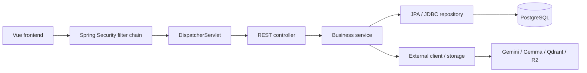

# Kiến trúc backend ShopFlow

Backend là một ứng dụng Spring Boot dùng Spring MVC REST, tổ chức theo các tầng ở
cấp package gốc `dev.hoangtuan.shopflow`. Frontend Vue là ứng dụng giao diện riêng;
controller trả JSON qua HTTP message conversion của Spring MVC.

Quyết định này thuộc SF-130/SF-131. Cấu trúc tham khảo Spring PetClinic REST và
EMSI-LearnHub; lựa chọn cách phân tầng ở root để người đọc nhận diện trách nhiệm
ngay khi mở source. Đây là lựa chọn của dự án; Spring không bắt buộc duy nhất một
cây package.

Xem [bảng chuyển source và quyết định chi tiết](backend-refactor-map.md) và
[báo cáo kiểm chứng](../qa-backend-architecture.md) của đợt refactor.

## Luồng xử lý



## Cấu trúc

```text
shopflow/
├── ShopflowApplication.java
├── config/                 # Security, OpenAPI, R2 và HTTP client configuration
├── controller/             # REST request mapping, HTTP validation và response
├── service/                # Nghiệp vụ, transaction, trạng thái, orchestration
├── repository/
│   ├── jpa/                # OrderRepository, PaymentRepository, ProductRepository
│   └── jdbc/               # SQL và projection của các luồng nghiệp vụ
├── model/                  # Entity, snapshot, enum và dữ liệu nội bộ theo nghiệp vụ
├── dto/                    # HTTP request/response theo nghiệp vụ
├── security/               # Principal, UserDetailsService, login rate limiter
├── exception/
│   ├── handler/            # ControllerAdvice có scope theo controller
│   └── <nghiệp vụ>/        # Exception nghiệp vụ
└── integration/
    ├── ai/                 # GemmaClient, GeminiEmbeddingClient
    ├── search/             # QdrantClient
    └── storage/            # ProductImageStorage (R2)
```

`model` và `dto` có subpackage theo nghiệp vụ để tránh trộn dữ liệu không liên
quan. Controller và service dùng tên nghiệp vụ rõ ràng. Các repository JDBC là
class cụ thể; không tạo interface/implementation song song khi chỉ có một cách
triển khai. Mapping ngắn giữ ở method thuần tại nơi sử dụng; mapper không truy vấn
database hay gọi dịch vụ ngoài. Routes dùng annotation controller. Helper riêng
không được gom vào một `utils` chung chỉ để có đủ thư mục.

Các class/type được nhiều tầng dùng có visibility `public`; constructor và method
chỉ phục vụ nội bộ entity vẫn giữ phạm vi hẹp. `AuthService` tích hợp trực tiếp
Spring Security và servlet session để thiết lập phiên; không thêm một tầng bọc
chỉ để che các kiểu servlet đã có.

## Trách nhiệm và chiều phụ thuộc

| Tầng | Trách nhiệm | Giới hạn |
|---|---|---|
| Controller | HTTP parameters/body, validation, danh tính người gọi, gọi service | Không gọi repository hoặc client ngoài trực tiếp |
| Service | Quy tắc nghiệp vụ, transaction, chuyển trạng thái, phối hợp repository/client | Không chứa SQL hoặc JdbcTemplate |
| Repository | SQL/JPA, bind parameter, khóa row và map dữ liệu/projection | Không gọi service/controller/security/client ngoài |
| Model / DTO | Dữ liệu, validation và hành vi cục bộ | Không truy cập DB hoặc gọi service/client |
| Integration | Protocol nhà cung cấp, timeout và kiểm tra response | Không gọi business service hoặc repository |
| Security / Config | Cấu hình filter chain, xác thực, phiên, bean hạ tầng | SQL tài khoản đi qua AccountRepository |
| Exception handler | Chuyển exception thành HTTP status/body đúng API contract | Giữ phạm vi controller để tránh thay đổi xử lý lỗi giữa các API |

Một số query chỉ đọc trả projection dạng record có cùng dữ liệu với response DTO;
DTO không có hành vi I/O. Những bản ghi phục vụ locking nằm trong repository như
`StockReservationRepository.StockRow`. Không biến mọi bảng thành entity chỉ để
đồng nhất hình thức.

## Ví dụ lần theo source

### Tạo đơn và thanh toán

`OrderController` → `OrderService` → `OrderRepository` và
`StockReservationService` → `StockReservationRepository`.

`OrderService.createOrder` mở transaction. Reservation dùng
`Propagation.MANDATORY`; kiểm tra khả dụng và giữ hàng chạy cùng việc persist
order/items và ghi stock movement. Các sản phẩm được khóa theo product ID. Giữ
`saveAndFlush` trước các thao tác JDBC cần đọc dữ liệu vừa ghi.

`PaymentController` → `PaymentService` → `PaymentOrderRepository`,
`PaymentRepository`, `StockReservationService`. Payment khóa đơn bằng orderRef,
kiểm tra trạng thái và kết quả trước đó. Thành công giữ reservation để giao;
thất bại/hết hạn giải phóng hàng trong cùng transaction. Thanh toán vẫn là mô phỏng.

JPA và JDBC dùng cùng DataSource/transaction manager. Không mở transaction độc
lập cho từng repository method, không đổi lock order hoặc bỏ conditional update
và kiểm tra số dòng bị ảnh hưởng khi tách tầng.

### Nhập, điều chỉnh, giao và hoàn hàng

`InventoryService`, `ReceivingService`, `DeliveryService`, `ReturnService` giữ
validation, kiểm tra giới hạn và chuyển trạng thái. Các repository JDBC giữ câu
SQL và thao tác khóa/ghi. Tồn kho, lịch sử trạng thái và stock movement phải commit
hoặc rollback cùng use case. Quyền duyệt/từ chối đổi trả của chủ shop tiếp tục
được kiểm tra tại controller vì phụ thuộc nội dung request.

### Dashboard

`DashboardController` → `DashboardService` → `DashboardRepository`.
Service xử lý khoảng ngày, lịch Việt Nam, zero-fill và ghép kết quả; repository
thực hiện aggregate. Chỉ số tiền dựa payment `SUCCESS` theo `paid_at`, dùng snapshot
order/items; giữ isolation `REPEATABLE_READ` và tránh nhân bản sau join.

### Catalog, ảnh và AI

`CatalogController` → `ProductService` → `ProductRepository`.
`ProductImageService` dùng repository JPA và `ProductImageStorage`; cleanup ảnh cũ
hoặc ảnh mới vẫn phụ thuộc kết quả transaction qua callback `afterCompletion`.

`ChatController` → `ChatService` → `CatalogSearch`, `CatalogReader`, `GemmaClient`.
`CatalogIndexController` → `CatalogIndexService` → `CatalogIndexRepository`,
`GeminiEmbeddingClient`, `QdrantClient`. Dữ liệu `ProductText` và `ModelReply`
được đặt ngoài service để client không phụ thuộc implementation của service.

Chat giữ timeout ngắn và model fallback; reindex giữ timeout riêng, batching và
chỉ xóa stale points sau khi mọi batch thành công. Bộ đếm quota và lịch sử hội
thoại giữ giới hạn hiện tại, xem API contract tương ứng.

## Tính tương thích và kiểm chứng

- `ApiContractTests` so sánh paths và schemas OpenAPI với bản trước refactor trong
  `backend/src/test/resources/api-contract.json`; loại metadata server để kiểm tra
  tập trung vào hợp đồng HTTP. Chỉ cập nhật fixture khi có thay đổi API được duyệt.
- `ArchitectureTests` kiểm tra cây package và import direction, đồng thời chặn
  JdbcTemplate/EntityManager trong service/security. Đây là kiểm tra source ở mức
  cơ bản; không thay thế review nghiệp vụ hoặc phân tích mọi dependency Java.
- Các test controller, data model, concurrency, auth/CSRF, R2 và AI/index hiện có
  được chuyển theo tầng tương ứng, giữ nguyên assertion nghiệp vụ.
- Database tables/columns, migration, URL, JSON/status/error, role và CSRF giữ
  contract. Đổi package không yêu cầu migration.

Lệnh kiểm tra:

```bash
bash backend/mvnw -f backend/pom.xml -B spotless:check clean verify
npm --prefix frontend run lint:ci
npm --prefix frontend run build
npm --prefix frontend run test:e2e
```

## Việc theo dõi riêng

SF-132 xử lý dependency Lombok/MapStruct chưa sử dụng. SF-136 xử lý N+1 ở danh sách
giao hàng và đổi trả. Đợt refactor SF-130 giữ hành vi truy vấn hiện tại; tách tầng
không tự chứng minh đã giải quyết hiệu năng hoặc giới hạn kích thước danh sách.

## Tham khảo

- [Spring MVC](https://docs.spring.io/spring-framework/reference/web/webmvc.html).
- [Spring PetClinic REST](https://github.com/spring-petclinic/spring-petclinic-rest/tree/afc8fc1d3b8ec8de69414482b3bd70a1da78cb95/src/main/java/org/springframework/samples/petclinic).
- [EMSI-LearnHub](https://github.com/EnniouarMohammed/EMSI-LearnHub/tree/9ab0acf18893382e7be1d5f8aea150e1ee1bfc39/src).
- [JPA và JDBC cùng transaction](https://docs.spring.io/spring-framework/docs/current/javadoc-api/org/springframework/orm/jpa/JpaTransactionManager.html).
